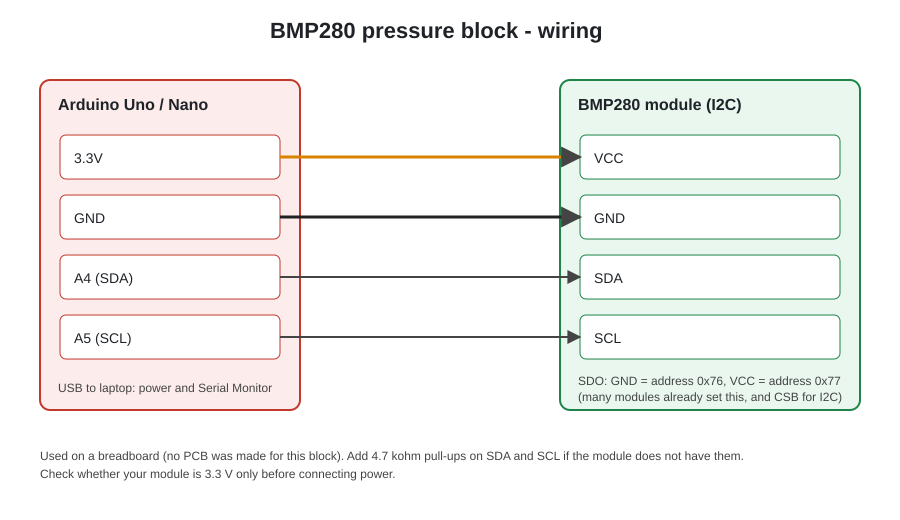
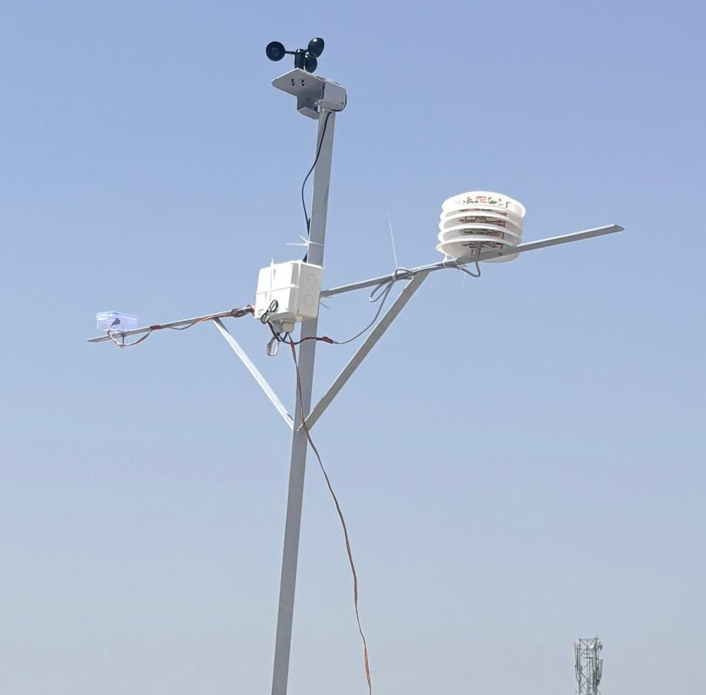
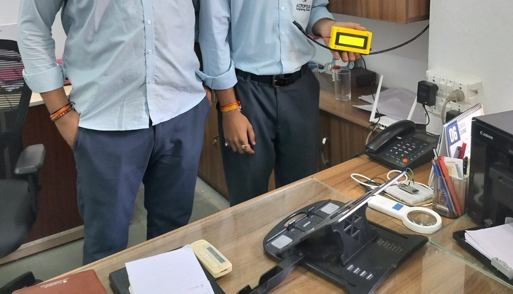
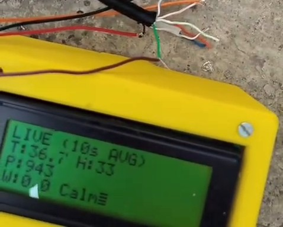

# Weather Station: BMP280 Pressure Block

An Arduino barometric-pressure block built as part of a class weather-station project in the ECE department of Acropolis Institute of Technology & Research, Indore (2026), under the guidance of Mr. Rajesh Murthy, founder of Contrive Technologies. The class built the weather station in blocks, and **our group built the pressure block** using a BMP280 sensor.



## About this project

The full weather station measures temperature, humidity, pressure and wind speed, averages them, and sends the result over an RS485 link to a display. Each group took one block (wind, temperature and humidity, pressure, communication). This repository has:

- **Our group's pressure block**, in `firmware/bmp280_pressure`
- **The class's final transmitter program**, in `firmware/class_station_final`, for context. It was written by the class, and our part in it is the BMP280 code.

See [`docs/system-overview.md`](docs/system-overview.md) for how the blocks fit together.

## The installed weather station

The finished weather station was installed on the rooftop of the ECE department. Its readings are shown on a small LCD in the HOD's cabin.

| Mast on the rooftop | LCD in the HOD's cabin | LCD readout |
|---|---|---|
|  |  |  |

The mast carries the anemometer on top, the electronics box in the middle, and the sensor housing on the arm. The readout in the video shows temperature, humidity, pressure and wind (here T 36.7, H 33, P 943 and wind 0.0 Calm). It is only an example of what the display showed, not an accuracy measurement.

## What the pressure block does

1. Reads atmospheric pressure from the BMP280 over I2C and converts it from pascals to hPa.
2. Takes a sample every 10 seconds.
3. Averages 15 samples (2.5 minutes) into one value.
4. Averages 4 of those values (10 minutes) into the final pressure.
5. Prints `LIVE,<hPa>` once at start-up and `FINAL,<hPa>` every 10 minutes, with 0 decimals, in the same style as the class station so it fits into one data line.

Example Serial Monitor output:

```
BMP PRESSURE READY
LIVE,1008
Sample: 1007.9
Sample: 1008.1
...
FINAL,1008
```

Typical readings are about 900 to 1013 hPa, depending on the height above sea level.

## The class program's data packet

The final transmitter program sends one line over RS485 at 9600 baud, once at start-up (`LIVE`) and then every 10 minutes (`FINAL`):

```
FINAL,26.9,49,1008,1.1,LightAir
```

The fields are packet type, temperature in degC, humidity in %, pressure in hPa, wind speed in m/s and the Beaufort label.

## Hardware (pressure block)

| BMP280 | Arduino |
|---|---|
| VCC | 3.3V |
| GND | GND |
| SDA | A4 |
| SCL | A5 |

The block was built on a breadboard, and no PCB was made for it. Components: [`hardware/bom.md`](hardware/bom.md).

## Run it

1. In the Arduino IDE, install the **Adafruit BMP280 Library** (it also installs Adafruit BusIO and Adafruit Unified Sensor).
2. Open `firmware/bmp280_pressure/bmp280_pressure.ino`, choose your board and port, and upload.
3. Open the Serial Monitor at **9600 baud**. If you see `BMP FAIL`, check the wiring and the sensor's I2C address (the sketch tries 0x76, then 0x77).

## Tests

Both programs are run on a PC with a fake clock and fake sensors:

```bash
# our pressure block
cd firmware/tests/host_sim
g++ -std=c++11 -I. sim_test.cpp -o sim_test
./sim_test step      # 60 samples in 10 minutes, LIVE and FINAL values correct
./sim_test addr77    # sensor answers only on 0x77, address fallback works

# the class transmitter program
cd ../host_sim_final
g++ -std=c++11 -I. sim_final.cpp -o sim_final
./sim_final          # LIVE and FINAL packets, averaging, RS485 direction pin
```

## Status

| Item | Status |
|---|---|
| Class weather station installed on the ECE department rooftop, readings on an LCD | Done |
| Pressure sketch used by our group on a breadboard | Done |
| Pressure sketch logic (sampling, two-stage averaging, output format, address fallback) | Checked in the PC simulation |
| Class transmitter program (packet format, averaging, RS485 direction pin) | Checked in the PC simulation |
| Pressure accuracy against a reference | Not measured in this repository |
| PCB for the pressure block | Not made |

The class program in this repository is the final transmitter program we have. Known issues are listed in [`docs/known-issues.md`](docs/known-issues.md).

## Repository layout

```
firmware/bmp280_pressure/      our pressure block
firmware/class_station_final/  class transmitter program (final)
firmware/tests/                PC simulations
hardware/                      wiring diagram and components
docs/                          system overview and known issues
media/                         photos of the installed station
```

## Team

Our group: Bhanu Pratap Singh Rajpoot, Bhavya Pahadiya, Krish Jain, Ashwathy Nair, Parth Marotkar and Gayatri Patel.

Built in the ECE department of Acropolis Institute of Technology & Research, Indore, under the guidance of Mr. Rajesh Murthy, founder of Contrive Technologies.

## License

[MIT](LICENSE)
